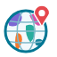
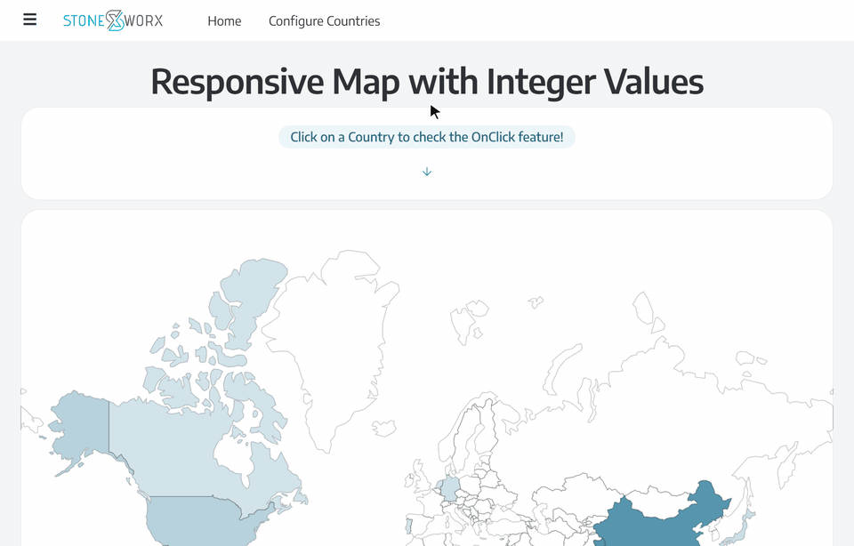
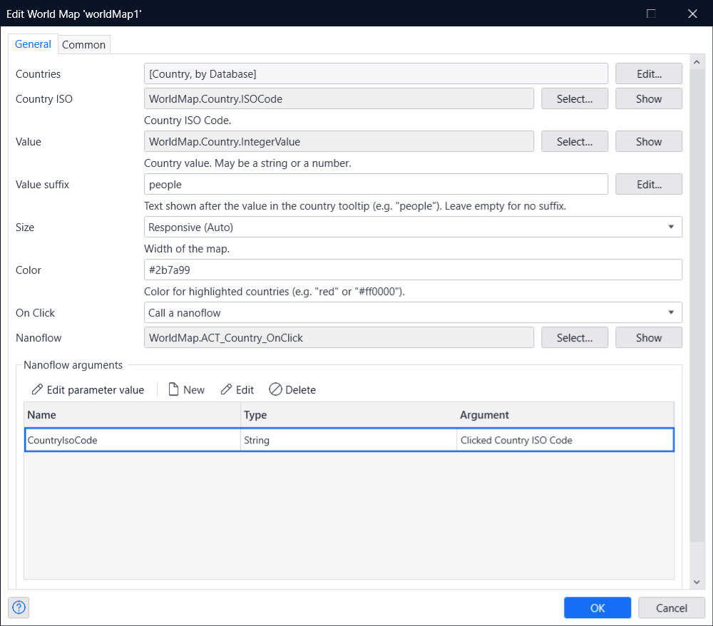
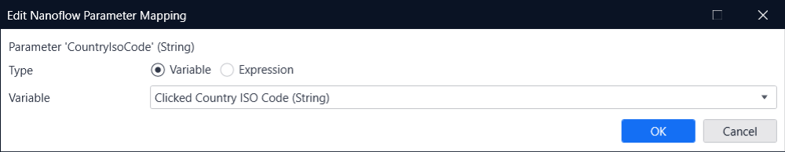
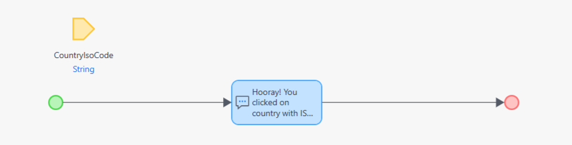
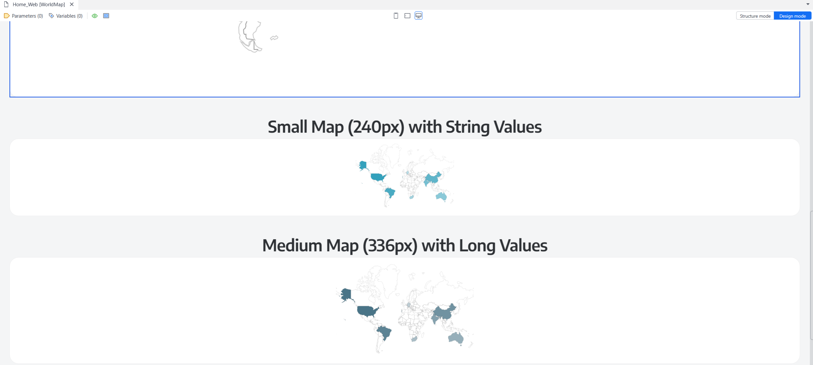
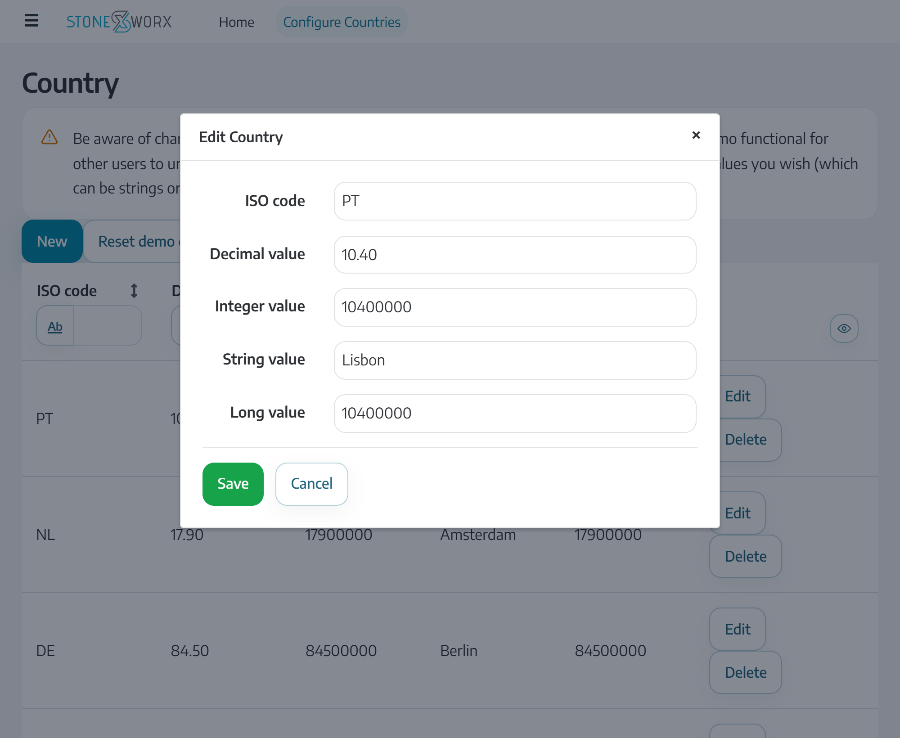
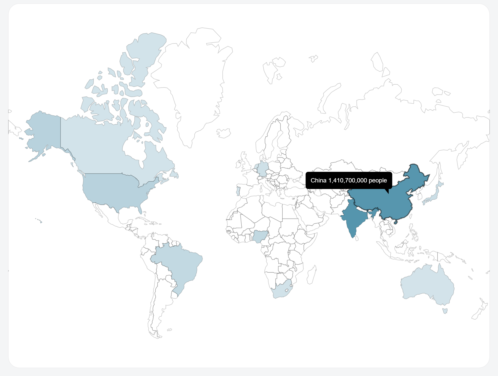

# World Map Mendix Pluggable Widget

World Map Mendix Pluggable Widget based on
[https://yanivam.github.io/react-svg-worldmap/](https://yanivam.github.io/react-svg-worldmap/) that allows you to draw
countries on a world map.

[Download the demo as a video (MP4, 41 s)](https://github.com/StoneworxNL/worldmap-mendix/releases/download/v2.2.0/WorldMap-demo.mp4)
· [Try the live demo](https://world-map-sandbox.mxapps.io/)

## Features

-   Shades each country by a number (Integer, Long or Decimal attribute): the higher the value, the stronger the color.
    Text (String) values highlight their countries and show the text in the tooltip.
-   Tooltips show the value formatted by Mendix in the user's language, with thousands separators, followed by an
    optional, translatable suffix such as "people".
-   A responsive size that fills its container, or fixed widths from 240px to 1200px.
-   An On Click action that receives the clicked country's ISO code.
-   Optional zoom and pan, with zoom buttons and country names that appear as you zoom in.
-   Optional pins: markers with a caption at a latitude and longitude, e.g. offices or cities.
-   Works anywhere on a page; no data view needed. The widget's Class and Style properties apply to the map.
-   A design-mode preview in Studio Pro.

## Requirements

Mendix 11.12.5 or later. The widget is built with the Mendix 11.15 widget tools and tested with Mendix 11.12.5.

## How To Use

1. Create an entity to store the countries (ISO code and value). It can be a database entity, or a non-persistent one
   that a microflow or nanoflow data source fills. Note that the value may be a number (Integer, Long, Decimal) or a
   string.
2. Add the 'World Map' widget to a page.
3. Set up the Countries' datasource, as well as the attributes you'd like to use for the ISO Code and Value.
4. Set the size and color. "Responsive" (the default) fills the width of its container, with a height of 3/4 of the
   width; the other sizes are fixed widths that shrink to fit a smaller container.
5. Optionally, set a value suffix to show after the value in the country tooltip, e.g. "people" (empty by default). It
   is a translatable text, so it can differ per language.
6. Optionally, turn on zoom and pan on the Zoom tab, and add pins on the Pins tab (see "Zoom and pins" below).

## Properties

| Property            | Description                                                                                                                                                                                                                     |
| ------------------- | ------------------------------------------------------------------------------------------------------------------------------------------------------------------------------------------------------------------------------- |
| Countries           | The data source with one object per country.                                                                                                                                                                                    |
| Country ISO         | String attribute with the country's two-letter ISO 3166-1 code, e.g. "PT". Case and surrounding spaces are ignored. Two regions use other codes; see "Tooltips and data" below.                                                 |
| Value               | Integer, Long, Decimal or String attribute. Numbers set how strongly the country is colored; text is shown in the tooltip.                                                                                                      |
| Value suffix        | Optional, translatable text shown after the value in the tooltip, e.g. "people". Empty by default.                                                                                                                              |
| Size                | Responsive (Auto), the default: the full width of the container, with a height of 3/4 of the width. Or a fixed width: sm (240px), md (336px), lg (480px), xl (640px) or xxl (1200px), which shrinks to fit a smaller container. |
| Color               | Color of highlighted countries, e.g. "red" or "#0f828c". If left empty, the map uses light gray (`#dddddd`).                                                                                                                    |
| On Click            | Optional action to run when a country is clicked. The clicked country's ISO code is available to it as the `$clickedIsoCode` variable.                                                                                          |
| Zoom and pan        | Zoom tab. Off by default. Lets users zoom and pan the map; see "Zoom and pins" below.                                                                                                                                           |
| Maximum zoom        | Zoom tab. How far users can zoom in, as a multiple of the whole map. Default 8, from 2 to 20.                                                                                                                                   |
| Zoom buttons        | Zoom tab. Shows the zoom in, zoom out and reset buttons in the map's bottom-right corner. On by default.                                                                                                                        |
| Country names       | Zoom tab. Shows the names of countries they fit inside; more appear as users zoom in. On by default.                                                                                                                            |
| Country name color  | Zoom tab. Color of the country names. If left empty, dark gray (`#222222`).                                                                                                                                                     |
| Pins                | Pins tab. Optional data source with one object per pin.                                                                                                                                                                         |
| Latitude, Longitude | Pins tab. Decimal, Integer or Long attributes with the pin's position in degrees: latitude from -90 to 90, longitude from -180 to 180. Pins without a valid position are skipped.                                               |
| Caption             | Pins tab. Text shown next to the pin, e.g. the city name. It can include attribute values.                                                                                                                                      |
| Pin color           | Pins tab. Fill color of the pins. If left empty, red (`#b91c1c`).                                                                                                                                                               |
| Class, Style        | The Common tab's Class and Style properties are applied to the map's root element.                                                                                                                                              |

### Tooltips and data

A country's tooltip shows its name, its value and the value suffix, e.g. "Brazil 216,400,000 people". Values are
formatted by Mendix in the user's language, with thousands separators.

The map draws 175 countries and territories. 173 of them use their two-letter ISO 3166-1 code, e.g. "PT". The other two
use three-letter codes: Northern Cyprus is `CYP` and Somaliland is `SOM`. Those happen to be the official three-letter
codes of Cyprus and Somalia, so if your data uses three-letter codes, `CYP` and `SOM` color Northern Cyprus and
Somaliland instead of being skipped, and clicking either region passes `CYP` or `SOM` as `$clickedIsoCode`.

Objects without a value, or with an ISO code the map doesn't know (e.g. "PRT"), are not shown. If several objects have
the same ISO code (ignoring case and spaces), the last one with a value is used. Long tooltips may extend beyond the
map; a parent container with `overflow: hidden` will clip them.

## Zoom and pins

With **Zoom and pan** on, users can zoom with the zoom buttons, by double-clicking, with Ctrl/Cmd + mouse wheel or a
trackpad pinch, or with the keyboard once the map has focus (`+` and `-` to zoom, the arrow keys to pan, Escape to
reset), and pan by dragging. A plain mouse wheel still scrolls the page. While zooming, the map shows the names of the
countries they fit inside. Clicking a country still runs the On Click action. A zoomable map clips its content to its
box, so tooltips near its edges can be cut off.

**Pins** are drawn with or without zoom. Each pin needs a latitude and a longitude; the caption is optional. Pins don't
respond to clicks.

When two pins overlap, counting their captions, only the one that comes first in the Pins data source is drawn, so sort
the data source by importance. Zooming in makes room for the others. **With zoom off, overlapping pins stay hidden, and
long captions hide more pins**: Studio Pro shows a warning for pins without zoom. Keep the Pins data source to a few
hundred objects at most (for example with an XPath constraint): every pin is checked against the others each time the
map zooms.

On a map without zoom, pin captions near the edge of the map can extend beyond it, like tooltips do.

Country names, the zoom buttons' screen-reader labels and the zoom status announcements come from react-svg-worldmap and
are in English only, also in apps in other languages.

## On Click Action

To handle clicks on the map, create a microflow or nanoflow with a String parameter to receive the clicked country's ISO
code, and select it as the widget's On Click action. In the action's settings, set that parameter to `$clickedIsoCode`.

The ISO code comes from the browser, so treat it like any other user input: validate it in your microflow (for example,
check that a matching Country object exists) before using it.

## Studio Pro preview

In Design mode, Studio Pro draws the map with sample countries, using the configured size, color and value suffix. The
preview always uses sample numbers, so even a map with a String value shows graded shading in Studio Pro. Structure mode
shows Studio Pro's default widget box.

## Live demo

[Try the World Map in a Mendix app running on the cloud](https://world-map-sandbox.mxapps.io/).

The demo shows four maps, one per value type: Integer (Responsive), String (240px), Long (336px) and Decimal (1200px),
each with its own value suffix in English and Dutch. Clicking a country on the first map runs a nanoflow that shows the
clicked ISO code. The Configure Countries page holds the data behind the maps. Its "Reset demo data" button, and a
scheduled event every day at 03:00 UTC, restore the sample data.

The demo is public, so please be mindful when changing its data, to keep it working for everyone.

### Countries' Configuration Example

### Responsive map

## Development

Building the widget needs Node 22, version 22.18 or later.

-   `npm run lint`: checks formatting and code style.
-   `npm test`: runs the unit tests.
-   `npm run build`: development build in `dist/<version>/`, also copied to the Mendix app set in `config.projectPath`.
-   `npm run release`: production build in `dist/<version>/`. Use this one for the Marketplace. It is not copied to the
    Mendix app: to try it, copy `dist/<version>/stoneworx.WorldMap.mpk` to the app's `widgets` folder yourself.

## Issues, suggestions and feature requests

Let us know if you find any issues or if you have any feature requests.
